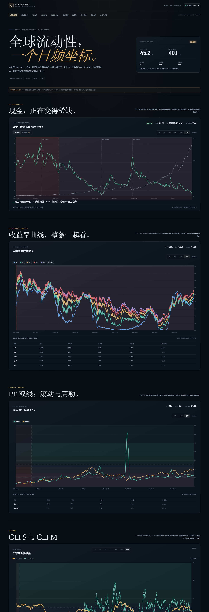

# GLI COMPASS · 全球流动性日频坐标

按 PDF 的五模块框架，构建一个可每日更新的 **Global Liquidity Index（GLI）** 仪表盘：

- **现金 / 股票市值**：1975–2026 的场外现金比例，首页长历史图
- **GLI-S**：全球流动性存量指数（0–100）
- **GLI-M**：全球流动性边际指数（0–100）
- **四象限**：存量 × 边际
- **五模块拆解**：央行/政策、美元、信用、跨境、融资条件
- **TQQQ 对比**：GLI-S 与 3 倍做多纳指100 的 TQQQ
- **月度读数日志**：最近 30 个月的状态、TQQQ 月收益
- **资产联动**：标普500、TQQQ、黄金、比特币、美元指数、10Y 美债



## 首页：现金 / 股票市值

现金 = 货币市场基金总资产 + 全部商业银行存款；分母 = 美国非金融企业股票市值。

- 比率：**0.335**（最新 Z.1 季度）
- 4 季度均值：**0.367**
- 2000 年低点：约 **0.32**
- 1982 年高点：约 **1.33**
- **估算周频**：最新约 **0.314**，13 周均值约 **0.298**
- SPY 右轴：2016 年前用 Shiller S&P 500 / 10 代理，2016 年后用实际 SPY

数据：Federal Reserve Z.1 / H.8，经 DBnomics；SPY 来自 Nasdaq，历史 S&P 500 来自 Robert Shiller / Yale。

图表顶部有 **官方季度 / 估算周频** 开关，两者分开绘制，不混在同一条线里；估算值明确标注 **ESTIMATED**。时间选项：1/3/5/10/20 年 + 全部，支持鼠标滚轮缩放。

## 重要说明：这是市场代理版

PDF 的完整 GLI 需要五家央行资产负债表、BIS 跨境债权、IMF COFER、EPFR 资金流等数据；这些数据没有稳定、免费、可每日获取的统一接口。

本站实现的是 **GLI-Market v0.1**：

| 模块 | 权重 | 日频代理 |
| --- | ---: | --- |
| 政策与久期 | 25% | 3M 美债利率（反向）、10Y 美债利率（反向）、TLT |
| 美元流动性 | 25% | 美元指数（反向）、UUP（反向） |
| 银行信用 | 20% | HYG/LQD、KRE/SPY |
| 跨境资金 | 15% | EEM/SPY、美元指数（反向） |
| 融资条件 | 15% | VIX（反向）、MOVE（反向）、HYG |

因此：

- 它适合跟踪**流动性的方向与相对状态**；
- 不能把 GLI 的绝对值当作“全球流动性总量”；
- 不是央行资产负债表、BIS/IMF 数据的替代品；
- 页面已明确标注“市场代理版”。

## 指数公式

每个代理变量先取 5 年滚动 Z-Score，并截断到 ±3：

```text
Z = (X − 5年均值) / 5年标准差
```

模块分数 = 模块内代理 Z-Score 的等权平均；然后：

```text
GLI-S = 50 + 10 × (0.25×政策 + 0.25×美元 + 0.20×信用 + 0.15×跨境 + 0.15×融资)
```

`GLI-S` 截断在 0–100。

边际指数：

```text
GLI-M = 0.5×Z(Δ3M GLI-S) + 0.3×Z(Δ1M GLI-S) + 0.2×Z(Δ6M GLI-S)
```

再映射到 0–100。四象限以 50 为分界。

## 时间范围与缩放

两张主图都支持：

- **1年 / 2年 / 3年 / 5年 / 8年 / 10年 / 全部**
- **鼠标滚轮缩放**：向上滚缩短时间窗，向下滚拉长时间窗
- 切换后 GLI-S / TQQQ 的 Z-Score 会按所选区间重新计算
- 滚动相关图同步截取

GLI-S 从 **2012-04-20** 开始；GLI-M 从 **2018-01** 开始。TQQQ 对比从 **2016-11** 开始（TQQQ 可用日线范围）。

## 纳指对比：为什么用 Z-Score

原来的“起点=100”会让 TQQQ 的大级别趋势把 GLI-S 压成一条近乎水平的线。

现在两条线都做：

```text
Z = (X − 区间均值) / 区间标准差
```

- 两条线均值都是 0、标准差都是 1
- 波动幅度站在同一把尺子上
- GLI-S 的起伏能清楚看到
- 图下方保留 **60 日滚动相关**

当前全期读数：

| 相关性 | 读数 |
|---|---:|
| 日相关 | **0.40** |
| 月相关 | **0.48** |
| 当前 60 日相关 | **0.49** |

TQQQ 是 **3 倍做多纳指100** 的杠杆 ETF，有每日再平衡和波动衰减，不适合当作长期持有收益的代理。

## 美国国债收益率

- 1994 至今：1Y / 5Y / 10Y / 20Y / 30Y
- 日频，可单独显示/隐藏每条线
- 白虚线 = 五个期限的当日中位数
- 右侧表格显示当前值、全样本中位数、20/80 分位和当前分位
- 时间选项：5/10/20 年 + 全部；滚轮缩放

## S&P 500 PE

- 1980 至今：滚动 PE + 席勒 PE
- 月度数据，双线对比
- 虚线 = 各自 1980 年以来中位数
- 表格显示当前值、中位数、20/80 分位和当前分位
- 时间选项：10/20 年 + 全部；滚轮缩放

## 当前快照（2026-11-13）

| 指标 | 读数 |
| --- | ---: |
| GLI-S 存量 | **45.2 / 100** |
| GLI-M 边际 | **40.1 / 100** |
| 状态 | **温和收紧** |
| 四象限 | **低位收缩** |
| 1M 变化 | -1.2 |
| 3M 变化 | -5.7 |
| GLI-S 历史分位 | 53% |

## 月度读数日志

页面末端新增最近 **30 个月**的月末读数：

- 月份
- GLI-S
- GLI-M
- 状态
- TQQQ 当月涨跌
- GLI-S 1M 变化

最新月份是数据日所在月，不是完整月末。

## 页面结构

- 现金 / 股票市值：1975–2026，官方季度 / 估算周频、4Q 或 13W 均值、SPY 右轴
- 美国国债收益率：1994–2026，多期限、可单独开关、中位数与分位表
- S&P 500 PE：1980–2026，滚动 PE / 席勒 PE、中位数与分位表

- GLI-S / GLI-M 主图：高度 650px
- TQQQ 对比图：主图 500px + 160px 滚动相关
- 五模块贡献：当前 Z-Score 与对 GLI-S 的点数贡献
- 四象限：近 2 年轨迹与当前位置
- 资产联动：近一年表现、与 GLI-S 日变化的相关性
- 月度日志：最近 30 个月
- 方法、数据来源与边界

## 快速开始

```bash
cd gli-compass
pip install -r requirements.txt
python scripts/update_data.py
python serve.py
# http://127.0.0.1:8767
```

如果 Yahoo 在当前网络返回 403，可运行：

```bash
python scripts/patch_tqqq.py
```

用 Nasdaq 的 TQQQ 日线补齐对比数据；GLI 主数据仍沿用最近一次成功的快照。

## 自动更新

工作流：[.github/workflows/update-and-deploy.yml](.github/workflows/update-and-deploy.yml)

```yaml
cron: "30 23 * * *"
```

- UTC 每天 23:30
- 对应 **北京时间每天 07:30**
- 美股收盘后拉取数据
- 自动重建 `site/data/gli.json`、`gli.js`、CSV
- 自动重建 `site/data/cash_equity.json`、`cash_equity.js`
- 自动部署 GitHub Pages

## GitHub Pages

仓库建议名：`gli-compass`

```text
https://zeraray929418798.github.io/gli-compass/
```

设置：**Settings → Pages → Source = GitHub Actions**，然后手动运行一次 **Actions → Update GLI data and deploy → Run workflow**。

## 目录

```text
gli-compass/
├─ .github/workflows/update-and-deploy.yml
├─ site/
│  ├─ index.html
│  ├─ styles.css
│  ├─ app.js
│  ├─ data/gli.js
│  ├─ data/gli.json
│  ├─ data/gli_daily.csv
│  └─ assets/chart.umd.min.js
├─ scripts/update_data.py
├─ scripts/patch_tqqq.py
├─ scripts/update_cash_equity.py
├─ scripts/update_yields.py
├─ scripts/update_pe_coppock.py
├─ data/raw/
├─ serve.py
└─ README.md
```

## 数据来源

- [Yahoo Finance](https://finance.yahoo.com/)：S&P 500、黄金、DXY、10Y、VIX、MOVE、3M、TLT、HYG、LQD、KRE、SPY、EEM、UUP
- [Nasdaq TQQQ](https://www.nasdaq.com/market-activity/etf/tqqq/historical)：TQQQ 日线；Yahoo 不可达时的对比数据来源
- [FRED Z.1 / H.8](https://fred.stlouisfed.org/)：货币市场基金、银行存款、股票市值
- [Robert Shiller / Yale](http://www.econ.yale.edu/~shiller/data.htm)：S&P 500 月线，用于 SPY 历史代理
- [Nasdaq SPY](https://www.nasdaq.com/market-activity/etf/spy/historical)：2016 年后实际 SPY 日线
- [DBnomics / Fed H.15](https://api.db.nomics.world/v22/series/FED/H15)：1Y/5Y/10Y/20Y/30Y 国债收益率
- [multpl · S&P 500 PE](https://www.multpl.com/s-p-500-pe-ratio)：滚动 PE
- [multpl · Shiller PE](https://www.multpl.com/shiller-pe)：席勒 PE
- 日频、共同交易日对齐
- GLI 数据日：2026-11-13；现金/股票最新季度：2026-06-30；页面生成：2026-11-20

## 边界

这是一个研究与教育工具，不构成投资建议。GLI-Market 是市场代理，不是央行资产负债表完整核算；GLI-S 从 2012-04 开始，GLI-M 从 2018 年开始，未覆盖 2008 年金融危机。TQQQ 是 3 倍杠杆 ETF，存在每日再平衡与波动衰减。历史分位、四象限和相关性都不代表未来。
